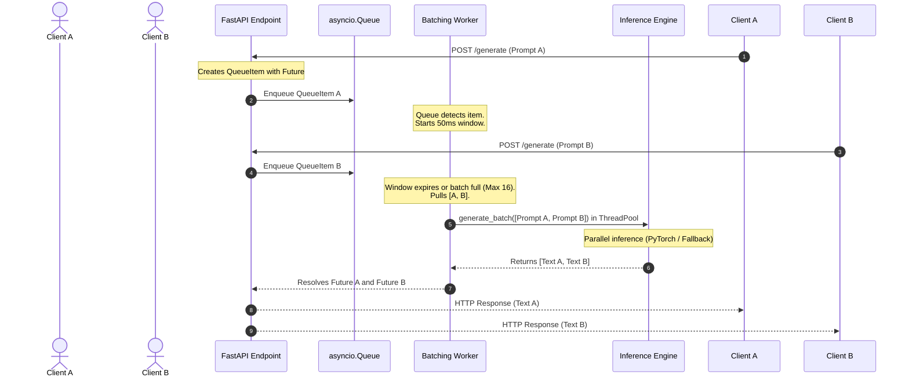

# LLM Inference Server

High-performance inference server optimized for running causal language models. This module implements advanced concurrency management and throughput optimization techniques, specifically Dynamic Request Batching and token-by-token response streaming (Streaming) via Server-Sent Events (SSE).

The server is designed to be compatible both with local accelerators (MPS/CUDA) loading Hugging Face CausalLM models, and with offline environments with no GPU resources, thanks to a deterministic semantic fallback engine.

## System Architecture and Dynamic Batching

The server's architecture is optimized to mitigate the traditional bottleneck in LLM inference: transferring weights from global memory (VRAM/RAM) to the processor's compute units (ALUs).



### 1. Dynamic Request Batching Mechanism

Instead of processing each inference request sequentially (incurring a critical overhead from loading the model weights on every query) or rejecting concurrent requests, the server implements a background asynchronous dispatcher:

1.  **Asynchronous Enqueuing:** Each incoming request to the `/generate` endpoint creates a `QueueItem` structure that encapsulates the prompt, the maximum number of tokens to generate, and an `asyncio.Future` object. The item is inserted into a thread-safe `asyncio.Queue`.
2.  **Batching Window:** When an item enters the empty queue, the `dynamic_batch_worker` wakes up and starts a configurable wait loop ($\tau = 50\text{ ms}$). During this window, it non-blockingly collects all subsequent concurrent requests.
3.  **Batch Constraints:** The worker stops accumulating items if the time window expires or if the batch reaches the maximum allowed size ($N_{\text{max}} = 16$).
4.  **Execution in a Thread Pool Executor:** Deep learning model inference blocks Python's Global Interpreter Lock (GIL) while doing heavy C++/CUDA computation. To avoid freezing FastAPI's async event loop, batch execution is delegated to an external executor via `loop.run_in_executor(None, engine.generate_batch, prompts, max_tokens)`.
5.  **Dispatch and Resolution:** When batch inference finishes, the worker associates the decoded responses with their respective `Futures`, notifying and releasing the suspended HTTP requests.

### 2. Inference Streaming via Server-Sent Events (SSE)

To optimize time to first token (TTFT), the `/generate_stream` endpoint exposes a persistent one-way connection using the Server-Sent Events (SSE) protocol. Token flow is managed as follows:

*   The server initializes a generator that consumes the inference engine.
*   On each generator iteration, a text fragment (token or subword) is emitted, encapsulated in a `token`-type event structured as JSON:
    ```json
    {
      "event": "token",
      "id": "uuid-v4-identifier",
      "data": "next_word "
    }
    ```
*   When generation finishes, the stream sends a `"data": "[DONE]"` control message with a `done` event and closes the connection safely.

### 3. Inference Engine and Offline Fallback

The `InferenceEngine` module handles hardware abstraction. It supports two operating modes:

*   **Online / Local Mode:** Loads CausalLM-architecture models (e.g. `sshleifer/tiny-gpt2`) via PyTorch and Transformers on the fastest compute platform available on the system (MPS on Apple Silicon hardware, CUDA on Nvidia systems, or CPU as a general fallback).
*   **Simulation / Offline Fallback Mode:** If the environment lacks GPU resources, a connection to download weights, or if compiler dependencies fail, a heuristic semantic engine kicks in. This engine analyzes the presence of key tokens in the prompt to structure coherent responses about AI concepts at a simulated generation rate (using random delays between `0.01` and `0.04` seconds per word to replicate real streaming behavior).

## Connection to the Ecosystem

Within the **ai-core-infra** suite, this server serves critical functions:
1.  **semantic-model-router:** The semantic router analyzes incoming client requests and redirects them to this inference server or to external proprietary APIs based on the query's complexity and sensitivity.
2.  **orchestra-agents:** Asynchronous agents and planners make recurring, concurrent queries to this module to resolve reflections, invoke tools, and synthesize observations without penalizing the main execution threads.

## File Structure

*   `inference_engine.py`: Encapsulated module that handles loading the Hugging Face model, batch tokenization, hardware-accelerated inference, and offline simulation methods.
*   `server.py`: FastAPI server definition, implementation of the dynamic dispatcher (`dynamic_batch_worker`) and the communication endpoints.
*   `test_server.py`: Asynchronous unit test suite that validates batching's concurrent behavior, behavior under errors and cancelled threads, and correct operation of SSE streaming.
*   `example.py`: Interactive client-server script that starts the FastAPI server, sends sequential requests, and simulates concurrent bursts to demonstrate dynamic batching while displaying live logs.

## Installation and Serving

### 1. Install Dependencies

Make sure to enable the project's virtual environment before installing:

```bash
python3 -m venv .venv
source .venv/bin/activate
pip install -r requirements.txt
```

### 2. Run Automated Tests

The test suite simulates the arrival of concurrent requests and verifies that they are correctly grouped and resolved in a single execution batch:

```bash
.venv/bin/python -m unittest test_server.py
```

### 3. Start the Local Server

You can start the FastAPI server directly using Uvicorn:

```bash
.venv/bin/python -m uvicorn server:app --host 127.0.0.1 --port 8000 --log-level info
```

### 4. Live Demonstration (Dynamic Batching)

With the server running in one terminal, run in another active terminal:

```bash
.venv/bin/python example.py
```

This script will fire multiple parallel calls asynchronously to observe dynamic batching reducing average latency and showing streaming output in the console.
